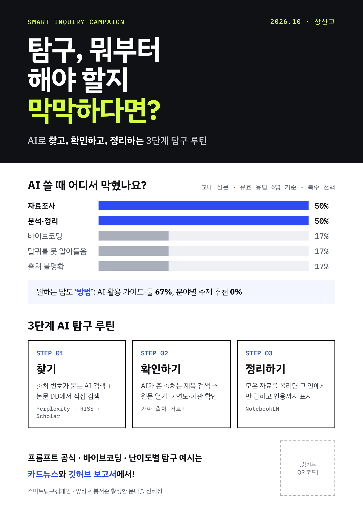
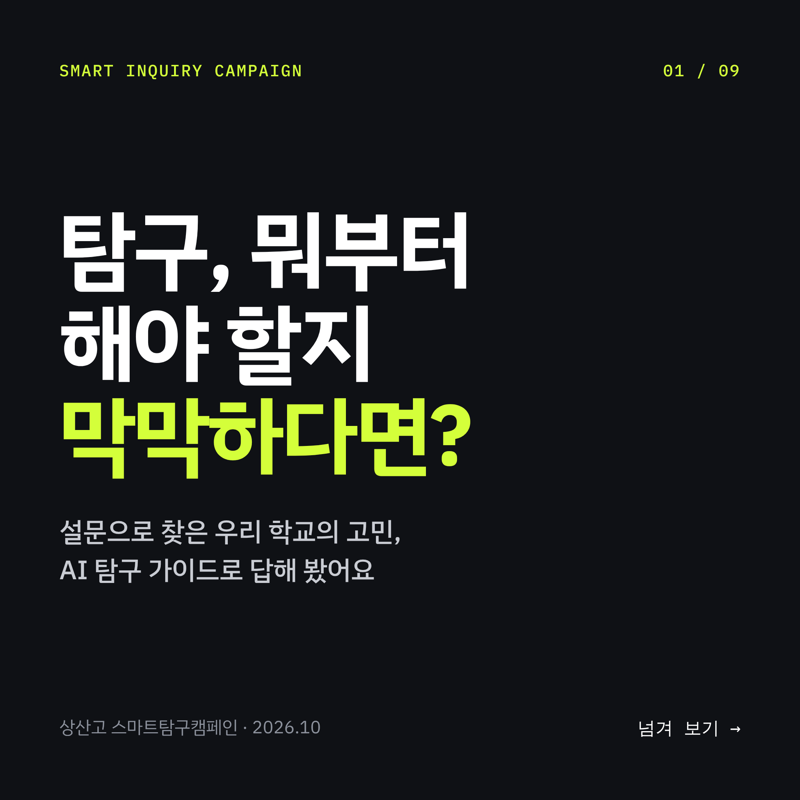
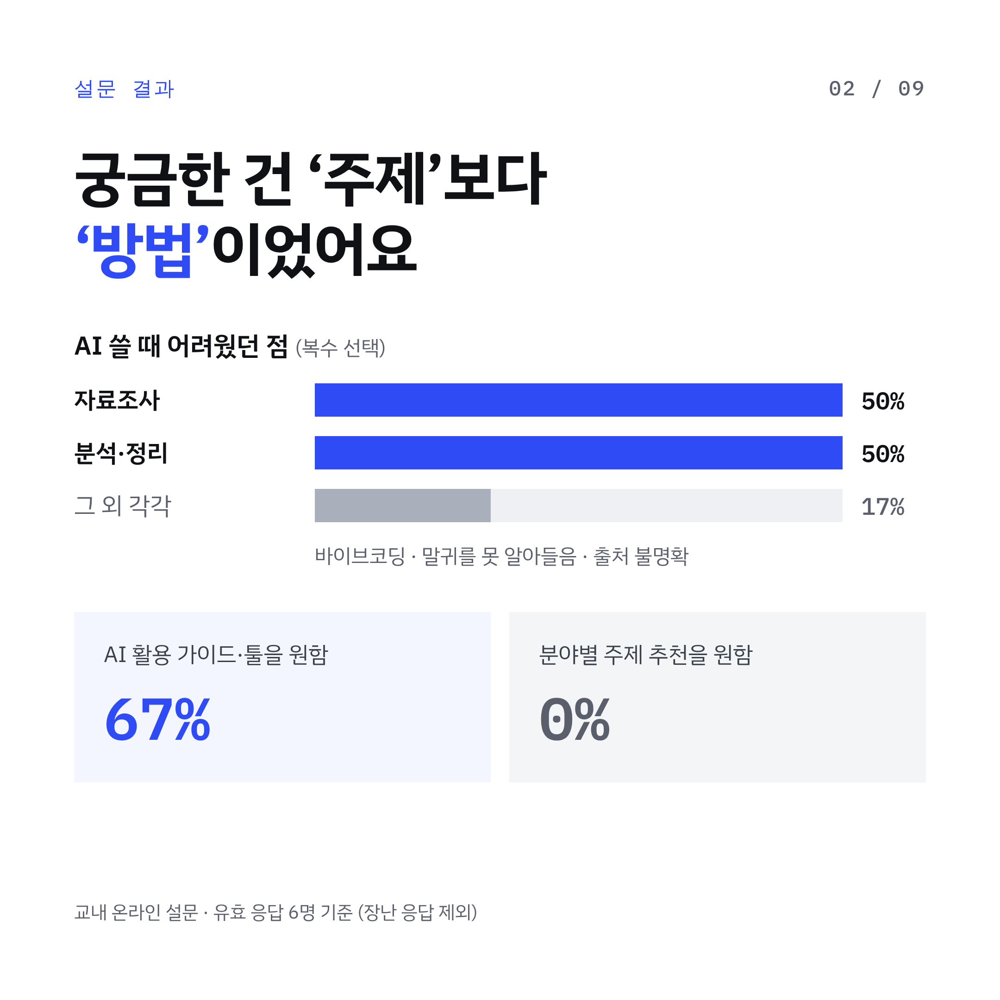
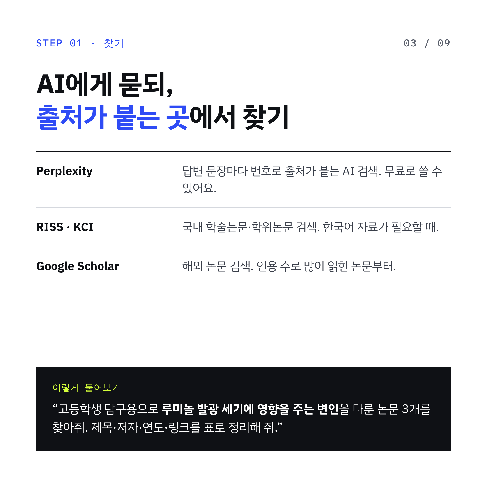
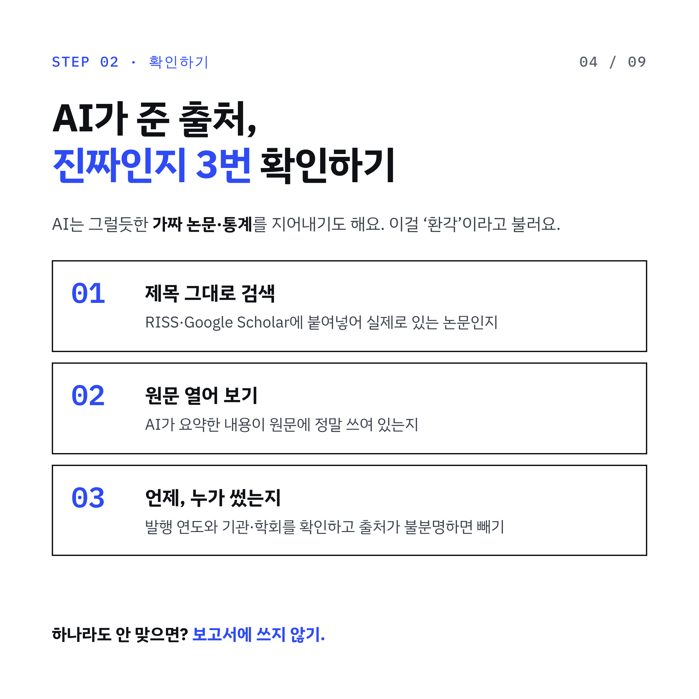
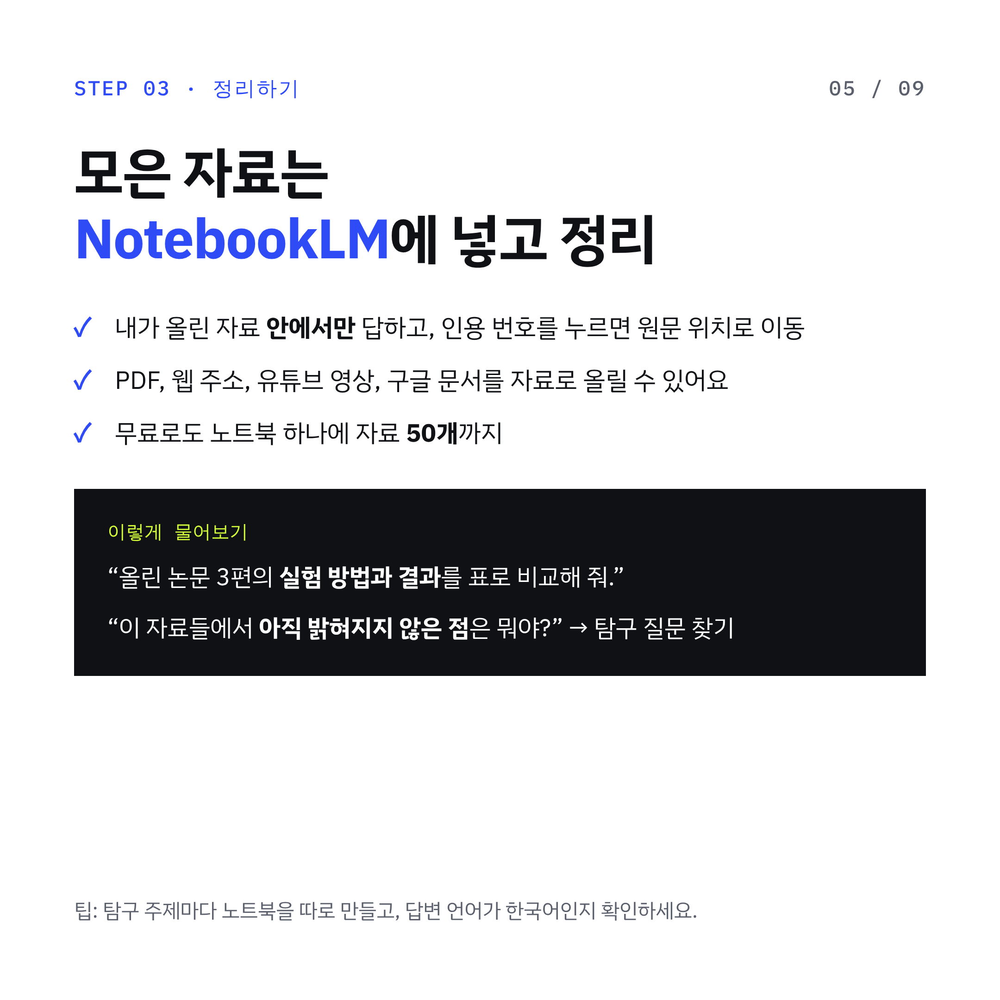
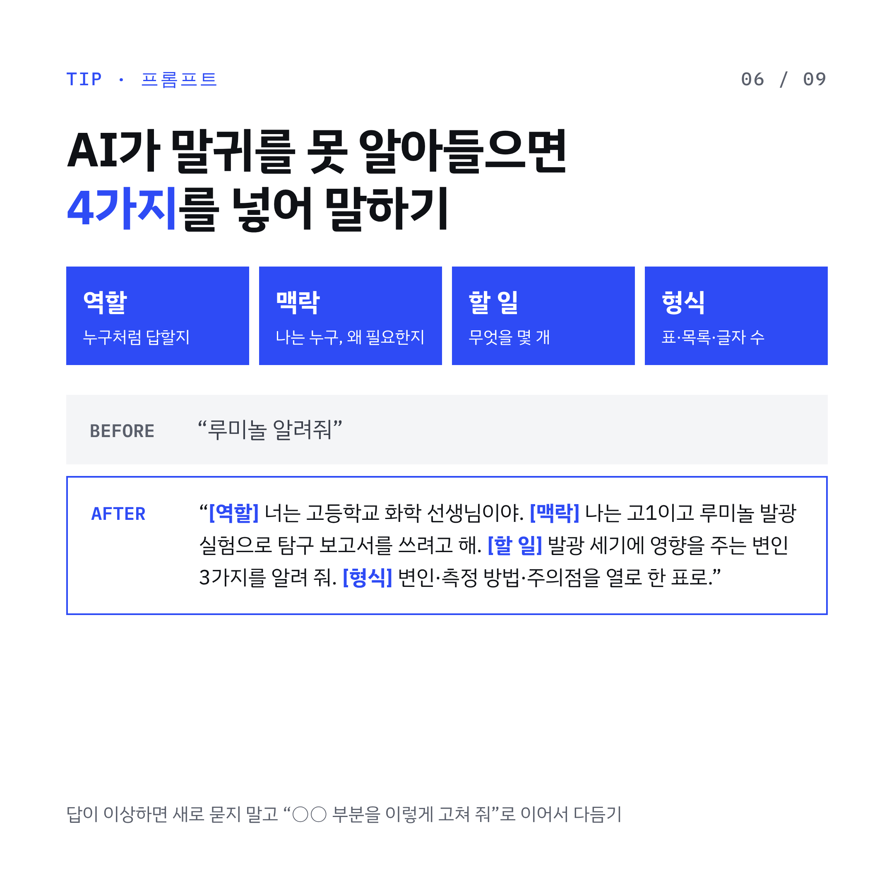
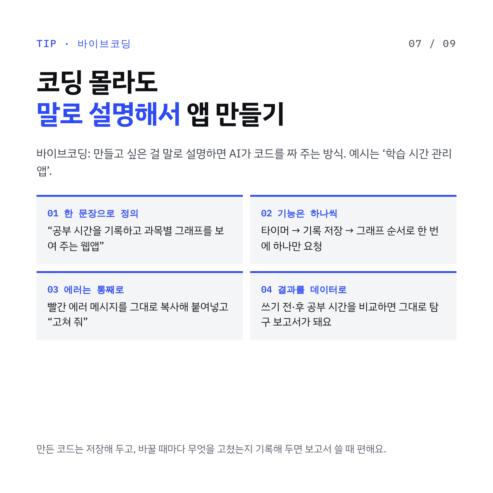
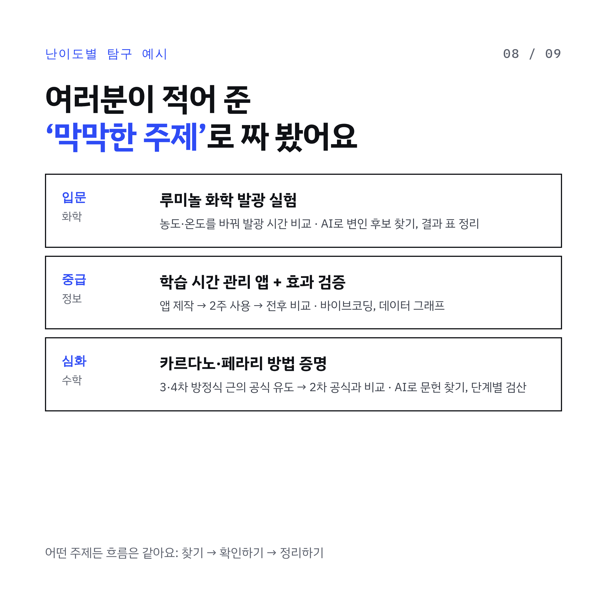
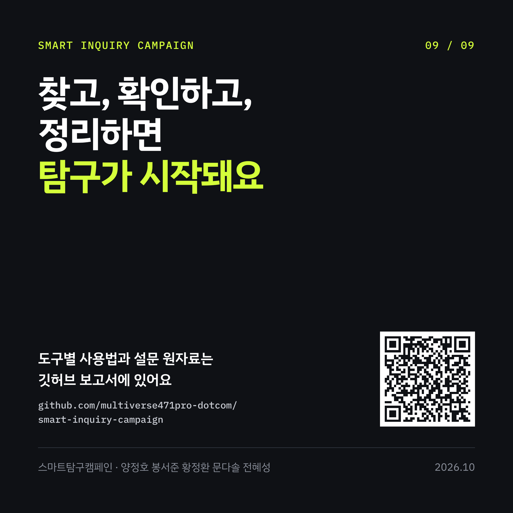

# 스마트탐구캠페인 — 탐구, 뭐부터 해야 할지 막막하다면?

> 본 저장소는 상산고등학교 학생주도 프로젝트형 봉사활동의 일환으로 작성되었습니다.

상산고 학생주도 프로젝트형 봉사활동(모둠형 · 캠페인활동)의 상세 보고서입니다.
교내 설문으로 학생들이 탐구할 때 어디서 막히는지 조사하고, AI 도구로 자료를 **찾고, 확인하고, 정리하는** 방법을 가이드로 정리했습니다.

## 1. 활동 개요

| 항목 | 내용 |
| --- | --- |
| 프로젝트명 | 스마트탐구캠페인 |
| 모둠원 | 양정호(학생대표), 봉서준, 황정환, 문다솔, 전혜성 |
| 활동 기간 | 2026년 9월 29일 ~ 10월 20일 (4일, 총 4시간) |
| 봉사활동 영역 | 캠페인활동 |
| 산출물 | 포스터, 카드뉴스 9장, 이 보고서, 설문 원자료 |

### 문제 의식

AI가 발전하면서 생기부 수준이 상향 평준화되었고, 단순한 자료조사만으로는 좋은 탐구를 보여 주기 어려워졌습니다.
실질적인 탐구·분석 능력이 필요하지만, 기술이 너무 빨리 바뀌어서 관심은 있어도 **무엇을 어떻게 준비해야 할지 모르는** 학생이 많습니다.

### 활동 목표

1. 교내 전체를 대상으로 온라인 설문 실시
2. 설문 결과를 바탕으로 학생들이 가장 필요로 하는 분야와 효율적인 활용법을 조사·정리
3. 조사한 내용으로 홍보물(포스터·카드뉴스)과 보고서 작성
4. 결과물을 학년 게시판에 게시하고, 상세 보고서를 깃허브에 올려 누구나 볼 수 있게 공개

### 활동 일정

| 차시 | 날짜 | 내용 | 장소 |
| --- | --- | --- | --- |
| 1 | 9월 29일 | 구글 설문지 제작 및 배포 | 교실 |
| 2 | 10월 6일 | 설문 결과를 바탕으로 찾아야 할 자료를 정하고 자료조사 | 교실 |
| 3 | 10월 13일 | 자료조사 결과를 바탕으로 초안 작성 | 교실 |
| 4 | 10월 20일 | 포스터·카드뉴스 학년 게시판 게시, 보고서 깃허브 업로드 | 학년 게시판, 교실 |

## 2. 설문 설계

- 제목: “탐구, 뭐부터 해야 할지 막막하다면?” (구글 설문지, 1분 익명 설문)
- 문항 5개: 객관식 4개 + 주관식 1개. 응답 부담을 줄이려고 학년 문항은 넣지 않았습니다.

| 번호 | 문항 | 유형 |
| --- | --- | --- |
| Q1 | 현재 본인이 관심 있는 분야는? | 복수 선택 + 기타 |
| Q2 | 탐구를 어느 수준까지 진행해 봤나요? | 복수 선택 + 기타 |
| Q3 | AI를 사용할 때 어떤 점이 어려웠나요? | 복수 선택 + 기타 |
| Q4 | 이번 캠페인에서 가장 얻고 싶은 답은? | 단일 선택 |
| Q5 | 관심은 있지만 어떻게 준비해야 할지 막막한 주제 | 주관식 |

## 3. 설문 결과

- 전체 응답 7개 중 **불성실 응답 1개(R3)를 제외한 유효 응답 6개**로 분석했습니다. R3은 Q2 모든 항목에 체크하고 Q3·Q5에 ‘x’, ‘xxx’를 적었습니다.
- R1의 Q5 장난 답변 1개도 제외했습니다. R1의 나머지 답변은 그대로 썼습니다.
- 비율은 모두 유효 응답 6명 기준입니다. Q1~Q3은 복수 선택이라 비율을 더하면 100%가 넘습니다.
- 원자료: [`data/survey_raw.csv`](data/survey_raw.csv)

### Q1. 관심 분야

| 분야 | 비율 |
| --- | --- |
| 의료 | 50% |
| 공학 | 50% |
| 바이오 | 17% |
| 우주 (기타 입력) | 17% |

### Q2. 탐구 진행 수준

| 단계 | 비율 |
| --- | --- |
| 아이디어 구상 및 정리 | 33% |
| 발표 및 정리 | 33% |
| 실험 | 33% |
| 새로운 창작물(프로그램·시제품) 제작 | 33% |
| 자료조사 및 정리 | 17% |

### Q3. AI를 쓸 때 어려웠던 점

| 어려운 점 | 비율 |
| --- | --- |
| 자료조사 | 50% |
| 분석 및 정리 방법 | 50% |
| 바이브코딩 방법 | 17% |
| 말귀를 못 알아들음 (기타 입력) | 17% |
| 출처 불명확 (기타 입력) | 17% |

### Q4. 캠페인에서 가장 얻고 싶은 답

| 원하는 답 | 비율 |
| --- | --- |
| AI 활용 가이드 | 33% |
| 사용 가능한 툴 | 33% |
| 난이도별 탐구주제 추천 | 33% |
| 분야별 탐구주제 추천 | 0% |

### Q5. 준비가 막막한 주제 (유효 답변)

- 루미놀 화학 발광 실험
- 수학 심화 탐구
- 페라리 해법과 카르다노 방법의 증명
- 학습·시간관리 앱을 만들고 사용 효과를 확인해 보고 싶다

## 4. 분석

1. **AI 사용의 어려움은 대부분 ‘자료조사·정리’에 몰려 있다.** 자료조사와 분석·정리가 각각 50%로 가장 많았고, ‘출처 불명확’까지 더하면 6명 중 5명이 조사·정리 단계에서 막혔습니다.
2. **학생들이 원하는 것은 ‘주제’보다 ‘방법’이다.** AI 활용 가이드와 사용 가능한 툴을 고른 학생이 합쳐서 67%였고, 분야별 주제 추천은 0%였습니다. 관심 분야는 이미 있는데, 그걸 탐구로 바꾸는 방법을 모른다는 뜻으로 해석했습니다.
3. **경험이 많을수록 다음 단계를 원한다.** 창작물 제작까지 해 본 학생(R1, R2)은 난이도별 주제를, 아이디어·자료조사 단계에 있는 학생(R4, R7)은 툴과 가이드를 골랐습니다.
4. **관심 분야와 실제 탐구 주제가 다르다.** 의료를 고른 학생 두 명이 Q5에 적은 주제는 모두 수학이었습니다. 진로 분야와 별개로 기초 과목 탐구 수요가 있습니다.

그래서 캠페인 자료는 **‘AI로 찾기 → 확인하기 → 정리하기’ 3단계 루틴**을 중심으로, 프롬프트 작성법·바이브코딩·난이도별 예시를 덧붙이는 구성으로 만들었습니다.

## 5. AI 탐구 가이드

### STEP 01. 찾기 — 출처가 붙는 곳에서

| 도구 | 쓰임새 |
| --- | --- |
| Perplexity | 답변 문장마다 번호로 출처가 붙는 AI 검색. 무료로 쓸 수 있음 |
| RISS · KCI | 국내 학술논문·학위논문 검색. 한국어 자료가 필요할 때 |
| Google Scholar | 해외 논문 검색. 인용 수로 많이 읽힌 논문부터 볼 수 있음 |

> 예시 질문: “고등학생 탐구용으로 루미놀 발광 세기에 영향을 주는 변인을 다룬 논문 3개를 찾아줘. 제목·저자·연도·링크를 표로 정리해 줘.”

### STEP 02. 확인하기 — AI가 준 출처, 진짜인지 3번

AI는 그럴듯한 가짜 논문이나 통계를 지어내기도 합니다(환각). 출처는 쓰기 전에 꼭 확인합니다.

1. **제목 그대로 검색** — RISS나 Google Scholar에 붙여넣어 실제로 있는 논문인지 확인
2. **원문 열어 보기** — AI가 요약한 내용이 원문에 정말 쓰여 있는지 확인
3. **언제, 누가 썼는지** — 발행 연도와 기관·학회를 확인하고, 출처가 불분명하면 빼기

하나라도 맞지 않으면 보고서에 쓰지 않습니다.

### STEP 03. 정리하기 — NotebookLM

- 내가 올린 자료 **안에서만** 답하고, 답변의 인용 번호를 누르면 원문의 해당 위치로 이동합니다.
- PDF, 웹 주소, 유튜브 영상, 구글 문서를 자료로 올릴 수 있습니다.
- 무료로도 노트북 하나에 자료 50개까지 넣을 수 있습니다.
- 탐구 주제마다 노트북을 따로 만들고, 답변 언어가 한국어인지 확인합니다.

> 예시 질문: “올린 논문 3편의 실험 방법과 결과를 표로 비교해 줘.” / “이 자료들에서 아직 밝혀지지 않은 점은 뭐야?”

### TIP. 프롬프트 — 말귀를 못 알아들으면 4가지를 넣어 말하기

| 요소 | 의미 |
| --- | --- |
| 역할 | AI가 누구처럼 답할지 |
| 맥락 | 나는 누구이고 왜 필요한지 |
| 할 일 | 무엇을 몇 개 |
| 형식 | 표, 목록, 글자 수 |

- Before: “루미놀 알려줘”
- After: “[역할] 너는 고등학교 화학 선생님이야. [맥락] 나는 고1이고 루미놀 발광 실험으로 탐구 보고서를 쓰려고 해. [할 일] 발광 세기에 영향을 주는 변인 3가지를 알려 줘. [형식] 변인·측정 방법·주의점을 열로 한 표로.”

답이 이상하면 새로 묻기보다 “○○ 부분을 이렇게 고쳐 줘”로 이어서 다듬습니다.

### TIP. 바이브코딩 — 말로 설명해서 앱 만들기

바이브코딩은 만들고 싶은 것을 말로 설명하면 AI가 코드를 짜 주는 방식입니다.

1. **한 문장으로 정의** — “공부 시간을 기록하고 과목별 그래프를 보여 주는 웹앱”
2. **기능은 하나씩** — 타이머 → 기록 저장 → 그래프 순서로 한 번에 하나만 요청
3. **에러는 통째로** — 에러 메시지를 그대로 복사해 붙여넣고 “고쳐 줘”
4. **결과를 데이터로** — 사용 전·후 공부 시간을 비교하면 그대로 탐구 보고서가 됨

### 난이도별 탐구 예시 (설문 Q5에서 나온 주제)

| 난이도 | 주제 | 탐구 흐름 | AI 활용 |
| --- | --- | --- | --- |
| 입문 (화학) | 루미놀 화학 발광 실험 | 농도·온도를 바꿔 발광 시간 비교 | 변인 후보 찾기, 결과 표 정리 |
| 중급 (정보) | 학습 시간 관리 앱 + 효과 검증 | 앱 제작 → 2주 사용 → 전후 비교 | 바이브코딩, 데이터 그래프 |
| 심화 (수학) | 카르다노·페라리 방법 증명 | 3·4차 방정식 근의 공식 유도 → 2차 공식과 비교 | 문헌 찾기, 단계별 검산 |

## 6. 카드뉴스

| 1. 표지 | 2. 설문 결과 | 3. 찾기 |
| --- | --- | --- |
|  |  |  |
| **4. 확인하기** | **5. 정리하기** | **6. 프롬프트** |
|  |  |  |
| **7. 바이브코딩** | **8. 난이도별 예시** | **9. 마무리** |
|  |  |  |

### 파일 안내

| 파일 | 내용 |
| --- | --- |
| [`poster/poster.png`](poster/poster.png) | 학년 게시판용 포스터 (A3 비율, 1680×2376px) |
| [`cardnews/`](cardnews) | 카드뉴스 9장 (각 2160×2160px) |
| [`data/survey_raw.csv`](data/survey_raw.csv) | 설문 원자료 7개와 유효 응답 여부 |

포스터와 카드뉴스 9번의 QR 코드를 찍으면 이 저장소로 연결됩니다.

## 7. 한계와 다음에 보완할 점

- **표본이 작다.** 유효 응답이 6명이라 결과는 경향으로만 볼 수 있습니다. 한 명이 비율을 약 17%p씩 움직입니다.
- **문항 설계.** Q3에 ‘어려운 점 없음’ 선택지가 없어 ‘x’ 같은 기타 입력이 생겼습니다. 분야 선택지에 수학·화학·정보 같은 기초 과목이 없어 Q5와 어긋났습니다.
- **학년 정보 없음.** 학년 문항을 빼서 학년별 비교는 할 수 없었습니다.
- 다음에는 응답 수를 늘리고, 선택지를 보완해 다시 조사해 볼 수 있습니다.

## 8. 기대 효과

1. 학생들이 과학기술 분야에 대한 이해와 흥미를 갖게 됩니다.
2. AI 도구를 직접 써 보면서 효율적으로 정보를 만들고 분석하는 역량을 기르고, 교내에 과학기술에 대한 관심을 나누는 분위기가 퍼집니다.
3. 모둠원과 협력해 활동을 수행하면서 팀워크를 기릅니다.

## 참고 자료

- [NotebookLM 사용법: 논문 정리부터 팟캐스트까지 (2026)](https://findskill.ai/ko/blog/notebooklm-%ec%82%ac%ec%9a%a9%eb%b2%95/)
- [The Best AI Research Tools in 2026](https://dupple.com/learn/best-ai-research-tools)
- [RISS 학술연구정보서비스](https://www.riss.kr)
- [Google Scholar](https://scholar.google.com)

---

상산고 스마트탐구캠페인 · 2026.10
